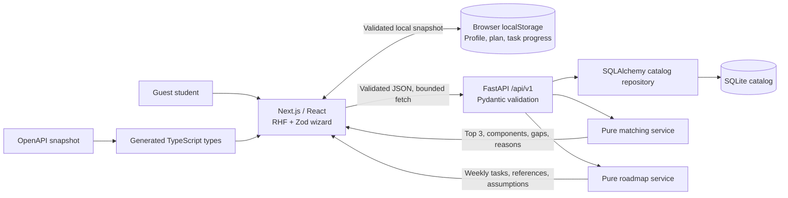

# Phases 1 and 2 architecture

PathForge AI is a local monorepo with a Next.js App Router frontend and an independent FastAPI service. SQLite stores career, skill and learning-resource catalogs plus administrator-managed guidance-expert records (including private contact fields). Matching and roadmap generation are stateless and deterministic. Core calculations use no AI. Optional provider wording is a separate opt-in augmentation; see the Phase 3 guide.

## Boundaries

- `frontend/app` owns pages; `components` owns accessible interactions; `lib/api` is the HTTP boundary; generated API types describe backend responses. `/careers/[slug]` presents career requirements and backend-calculated fit; `/roadmap` presents weekly tasks and completion controls. RHF and Zod catch mistakes before submission. Backend validation is authoritative.
- `backend/app/api` translates HTTP into validated requests and responses. It loads catalog data through SQLAlchemy and invokes the matching service.
- `backend/app/services/matching.py` owns pure scoring and gap calculation. It neither makes network calls nor persists profiles. Same input and catalog produce the same ordered output.
- `backend/app/services/roadmap.py` owns prerequisite traversal, resource selection, activity generation, and weekly packing. It returns deterministic IDs, assumptions, and warnings without network calls or student-data writes.
- The profile provider and storage utilities own hydration, versioned local persistence, profile/plan consistency, progress calculations, and clearing saved data. Cached JSON and resource URLs are validated before display.
- `backend/app/models` and Alembic own the catalog schema. Migration `0002` adds learning resources and resource-to-skill relationships to the existing database. The seed command is idempotent and migration-based initialization is explicit.
- `backend/tests`, `frontend/tests`, and the browser smoke suite verify the arithmetic, validation, API contract, and real guest journey.

## Privacy and trust

The guest profile, matches, selected career, active plan, and task completion are saved in versioned browser-local storage. Refresh restores validated state. No server-side profile, roadmap, or progress tables are created. There are no public profile IDs, profile-read endpoints, or authentication claims. No email, phone, Aadhaar, gender, caste, religion, or financial account data is requested. Study field is free text, so users should keep it general.

Local storage belongs to this browser and origin, not an account. It is not encrypted or protected from other people using the same browser; use **Clear saved data** on shared devices. Browser deletion, private browsing, changed origins/ports, or blocked storage can remove progress. If storage is unavailable, the app continues in memory with an explicit notice. One active plan is supported; there is no cross-device sync or account recovery.

The frontend rejects corrupt or incompatible cached state and validates links before rendering them. Changed submitted profile inputs invalidate an older plan. Task completion changes local plan progress, not skill levels, exploration fit, or proof of job readiness. Reopening a prerequisite also reopens dependent completions so saved progress remains consistent.

Requests send a profile snapshot to the local API for evaluation. Application logs contain request metadata, not profile payloads. Validation errors omit rejected input values. Guest use is supported without login. This is a prototype privacy boundary, not a production identity system.

API errors have a stable JSON envelope. CORS uses explicit frontend origins and matching requests are bounded by client timeout. There are no paid endpoints requiring AI rate limits. Internet access is needed to install dependencies, but matching runs from the local database without remote services.

## Scores and limits

See [matching-rules.md](matching-rules.md) for the complete rule table. Education, study field, goal, and language do not affect ranking. Protected attributes are not accepted. Self-reported coverage and exploration fit are advisory, revisable heuristics; neither measures job readiness nor predicts employment.

The planner selects free references first, respects the total resource-fee budget, orders prerequisites before dependent work, and splits tasks within weekly hours. Phone alternatives remain labeled as theory; computer practicals and supervised equipment requirements are not waived. Resource durations are illustrative study allocations, not provider course durations. See [roadmap-rules.md](roadmap-rules.md) and [resource-verification.md](resource-verification.md).

Initial Marathi navigation/onboarding, optional Gemini wording and practice quizzes are implemented; see the Phase 3 guide for exact coverage. Other UI uses explicit English fallback. Deployment and submission are pending.

## Expert administration addition

See [expert administration](expert-administration.md). A backend-only bearer token guards CRUD routes; public responses filter active, visible, verified and approved experts and redact private contact. Demo experts cannot be available for consultations. Migration `0003_experts` adds persistent records independently of the pitch team. Durable hosting storage is required before relying on expert data in production. Student matching/planning remains stateless.

## Optional learning additions

[Phase 3](phase3-guide.md) adds stateless server-side quiz grading and opt-in wording without changing the pure match/planning services. The server-only versioned quiz bank never exports correct-option fields through GET contracts. Passing practice badges are browser-local, separate from self-reported skills. A bounded Gemini HTTP adapter validates prose and original task/resource identities, with deadline, request limits and rule fallback. Language context and a dictionary cover initial Marathi navigation/onboarding, with explicit English fallback elsewhere. Student profiles and assessment attempts are not stored server-side.
